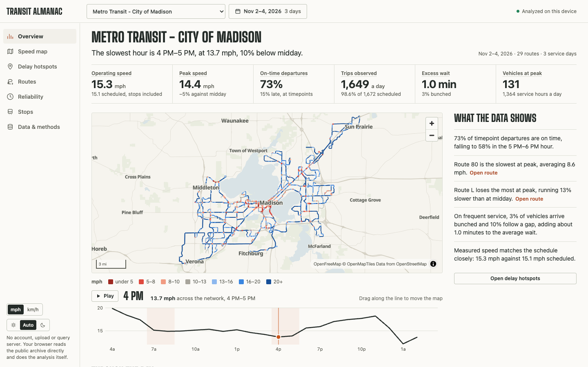
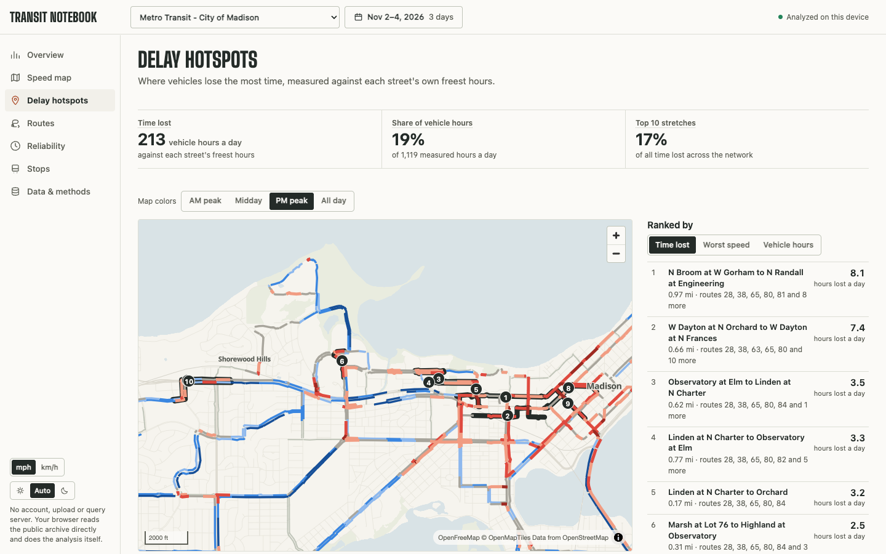
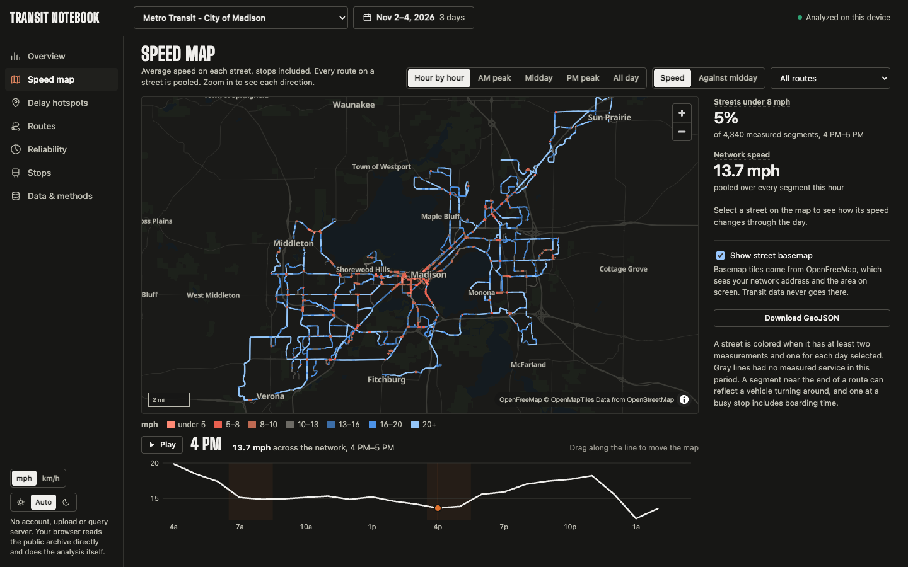
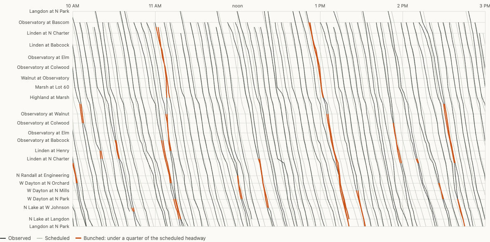
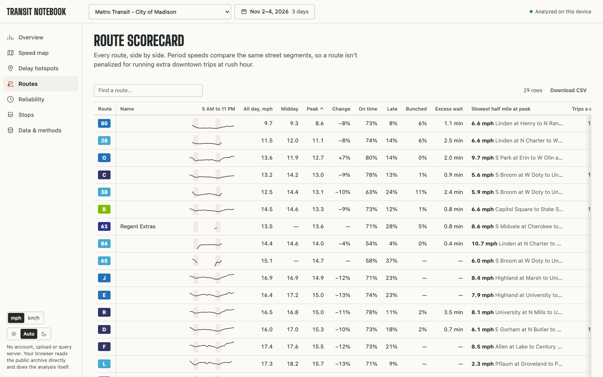
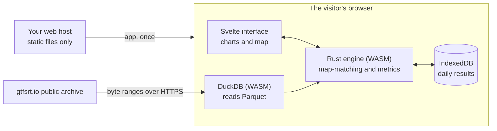

# Transit Notebook

**The performance reporting a transit planner would spend weeks building, for any agency in the [GTFS-RT archive](https://gtfsrt.io), running entirely in your browser.**

Pick an agency and some days. Your browser reads the public archive directly and works out how service really ran: speeds street by street and hour by hour, on-time performance, headways and bunching, run times, delay hotspots and stop spacing. There is no account, no upload and no query server, and the site hosting the app never sees the data.



The method comes from the [CTA Bus Speed Scorecard](https://michaelmclean.me/cta-bus-speed-scorecard), generalized from one city's bus tracker to any agency publishing GTFS-RT and GTFS.

## What it answers

| Report | Questions it answers |
| --- | --- |
| **Overview** | How fast is the system, how reliable is it, and when is it worst? Key figures, an hour-by-hour speed map, computed findings, four linked charts through the day, the slowest routes and a day-by-day check. |
| **Speed map** | Where do vehicles crawl, and when? Average speed on every street for every hour, with a slider built on the network's own speed curve. Compare any hour against midday, filter to one route, select a street for its hourly profile, and download GeoJSON for GIS. |
| **Delay hotspots** | Where is the most time lost? Ranked stretches by vehicle hours lost per day against each street's own freest conditions, pooled across every route, on a map. This is the starting list for bus lanes and signal priority. |
| **Routes** | Which routes need attention? A sortable scorecard with midday and peak speed on the same street segments, bootstrap intervals, on-time performance, excess wait, run time, the slowest half mile and an hourly sparkline, plus a route-by-hour heatmap. |
| **Route detail** | What is going wrong on this route? Speed by distance and hour, a string-line (Marey) diagram of every trip against the schedule, run time distributions by hour, delay building along the route, headways against the schedule, and a stop table. |
| **Reliability** | Is service on time and evenly spaced? An adjustable on-time window, on-time by hour, the deviation distribution, route rankings, bunching and gaps. |
| **Stops** | Are stops too close together? Spacing distribution, spacing by route, a map of closely spaced stops, and time spent around each stop. This is the groundwork for stop consolidation. |
| **Data & methods** | Can I trust this? Feed coverage by day and hour, the funnel from raw rows to measurements, the schedule versions used, every definition and threshold, the exact SQL, and a provenance download. |

Every table exports to CSV. Links carry the selection, and whoever opens one analyzes the same days on their own device.

<table>
  <tr>
    <td></td>
    <td></td>
  </tr>
  <tr>
    <td></td>
    <td></td>
  </tr>
</table>

## How it works



For each service day, DuckDB reads only the time window it needs from each archive file, and hands the columns straight to Rust. Rust map-matches every GPS fix to the trip's GTFS shape, works out when each stop was passed, and rolls everything into sums per route, hour, stop and street segment. Because those sums are additive, any set of days merges without loss, so filters and new views take milliseconds and never go back to the source.

Finished days are stored in your browser. Reopening a report takes about a second, and studying more days means analyzing only the new ones.

**Why Rust and TypeScript?** Rust does what it's fastest at: walking millions of positions. A typical day takes about 120 ms natively and well under a second in the browser, so most of the waiting is the download. The interface is Svelte and TypeScript, because Rust can't make the DOM faster and hand-built SVG charts are simple to write there. [The architecture document](docs/architecture.md) covers this in full.

## Getting started

Development needs Node.js 22 or newer and a rustup-managed Rust install. Visitors need only a browser.

```sh
npm ci --ignore-scripts
cargo install wasm-bindgen-cli --version 0.2.105 --locked

npm run build:wasm    # compile the Rust engine
npm run dev           # Vite dev server with hot reload
```

Open the URL Vite prints. Rerun `npm run build:wasm` after changing Rust. The pinned toolchain in `rust-toolchain.toml` includes the WASM target. `CARGO` and `WASM_BINDGEN` can override tool paths.

To build and preview the release under its real security policy:

```sh
npm run build            # dist/ is the deployable site
npm run verify:release   # check the release contents
PORT=4173 npm run preview
```

Then open <http://127.0.0.1:4173/gtfsrt-dashboard/>. The build downloads the official signed DuckDB extensions once, checks them against pinned SHA-256 hashes, and packages them into `dist/`. See [hosting](docs/hosting.md) to deploy.

## Project layout

```
crates/core/    Rust analytics, with no browser dependencies, tested natively
crates/wasm/    Browser bindings for the engine
src/engine/     Worker that drives DuckDB and Rust, local cache, network rules
src/views/      One file per report
src/charts/     SVG and canvas charts
src/map/        MapLibre map, basemap style, hour slider
src/lib/        Application state, formatting, scales
scripts/        Build, release checks, preview server, security headers
tests/          Contract and end-to-end tests
docs/           Architecture, metrics, validation, hosting, security
spike/          The original feasibility probe, kept for reference
```

## Testing

```sh
cargo test -p transit-core                                    # analytics, on simulated vehicles
cargo test -p transit-core --test sql_contract -- --ignored   # generated SQL in a real DuckDB
npm test                                                      # URL rules, dates, CSV safety, security policy
npm run check                                                 # TypeScript and Svelte
npm run test:e2e                                              # the built release against the live archive
```

The end-to-end test runs the production build under its real security policy and renders every report. It fails if the browser contacts any host other than the app, the archive and the basemap, or reads archive data before being asked. Set `CHROME_PATH` to use a specific browser.

Rust analytics tests drive simulated vehicles through a real schedule and assert the outcomes: a late trip lands in the late bins, a missing trip reads as a gap, a vehicle swap counts as one trip, service past midnight UTC stays on one service date, and so on. `crates/core/examples/replay.rs` replays a real day from CSV exports for checking against raw data.

## Can I trust the numbers?

The [metrics reference](docs/metrics.md) gives every definition, formula and threshold. [Validation](docs/validation.md) records what was checked and what wasn't. A second implementation, written by a separate AI review agent over the same raw data, agrees with the app to within 0.02 mph network-wide in Madison and King County, and every one of the archive's 21 vehicle-position feeds runs without error. That's agreement between methods, not ground truth, and no person has audited it yet. The short version of the limits:

- **Stop passes are inferred from GPS.** At 20-second polling, single events are approximate and aggregates are solid. Stop-zone time in particular only means something in aggregate.
- **An absent trip isn't proof of a cancellation.** It may be a reporting gap. The app reports what it observed and shows the share of scheduled trips it saw.
- **The archive has no ridership.** Hotspots report vehicle hours, not rider hours.
- **Some agencies can't be joined to a schedule.** When realtime trip IDs match no archived schedule, or no schedule exists, the app shows GPS speeds only and says so. Those speeds read about 5-10% below schedule-joined speeds network-wide, and up to 20-25% below on winding routes, so use them to compare routes and times of day. On-time performance and headways need the join.
- **The newest day is incomplete.** Evening service spills into the next UTC file, so the default selection stops one day short of the archive's newest file.
- **It has been tested in Chromium.** Safari, Firefox, Edge and low-memory devices still need testing before claiming support.

## Privacy and security

The website serves static files and receives no transit data. Your browser fetches data directly from Google Cloud Storage, which hosts the archive and sees your network address and which files you request. The optional street basemap comes from OpenFreeMap, which sees your network address and the area on screen, and you can turn it off. There is no analytics.

Results stay in your browser until you clear them from Data & methods. Raw vehicle data is never stored.

The production policy allows scripts and workers only from the app itself, with WASM but no JavaScript evaluation, and connections only to the archive bucket, Chicago Transit Alerts positions, and basemap. All SQL comes from fixed templates. [Packaging and security](docs/packaging-security.md) has the details.

## Documentation

- [Metrics reference](docs/metrics.md): every number, how it's calculated, and its limits
- [Architecture](docs/architecture.md): the pipeline and why it's built this way
- [Validation](docs/validation.md): independent checks and agency coverage
- [Hosting](docs/hosting.md): deploying to michaelmclean.me or anywhere else
- [Packaging and security](docs/packaging-security.md): release contents and the security model
- [Feasibility decision](docs/feasibility.md): the original proof that this could work
- [Design system](DESIGN.md) and [product brief](PRODUCT.md)

## Where this is heading

These reports exist to change something on the street. The natural next steps build on the same daily rollups:

- **Before and after comparison:** two date ranges side by side, to evaluate a bus lane or a service change.
- **Scenario tools:** estimate the time saved by consolidating these stops or giving this stretch a bus lane, using the measured stop and delay data.
- **Rider weighting:** join agency ridership where it's published, to turn vehicle hours into rider hours.
- **Crowding:** the rollups already keep occupancy where feeds report it, and it needs a report.
- **Published aggregates:** a static set of prebuilt rollups for instant national comparisons, with no server.

## Credits

Data from the [GTFS-RT archive at gtfsrt.io](https://gtfsrt.io), built on [Jarvus's archiver](https://github.com/JarvusInnovations/gtfs-realtime-archiver). Built with [DuckDB](https://duckdb.org), [MapLibre](https://maplibre.org), [OpenFreeMap](https://openfreemap.org), [OpenStreetMap](https://www.openstreetmap.org/copyright) data and [Svelte](https://svelte.dev). Display type is [Big Shoulders](https://github.com/xotypeco/big_shoulders).

Built by [Michael McLean](https://michaelmclean.me).

### Chicago Transit Alerts positions

Choose CTA Bus or Rail (Chicago Transit Alerts) in the agency picker. These feeds provide GPS speeds and coverage, with known polling gaps and station estimates accounted for. The browser verifies daily Parquet files against an immutable manifest. Data & methods includes the manifest, file revisions, and a link that pins the selection. Schedule comparisons require a trip match. The default selection is one weekday.

Run the live archive checks with `npm run test:e2e`. Run the local-file browser fixture with `node tests/e2e-local.mjs` after building WASM. Both accept `CHROME_PATH` for an installed Chrome executable. The local fixture makes no position-file network requests.
