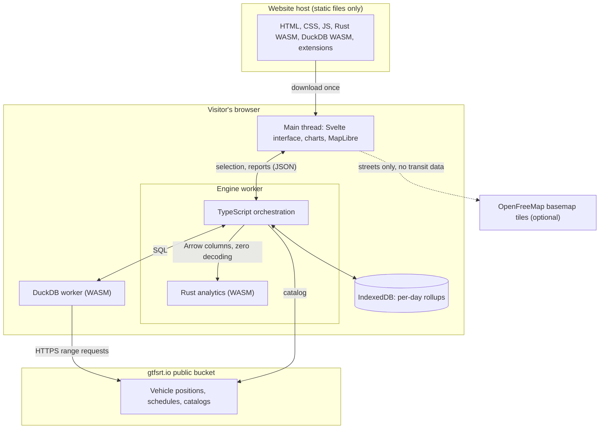
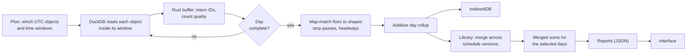

# Architecture

Transit Notebook is a static web application. The website host serves files and nothing else. Each visitor's browser downloads the app, reads the public archive directly, and does all of the analysis on their own device.

That decoupling is the central design constraint. No transit data passes through the website, and the app keeps working however many people use it, because every visitor brings their own compute.



## Why these technologies

| Layer | Choice | Why |
| --- | --- | --- |
| Analytics | **Rust, compiled to WASM** | Map-matching and stop-event detection walk every GPS fix. A typical day takes about 120 ms natively and well under a second in the browser. This is where Rust's speed matters. |
| Parquet I/O | **DuckDB-WASM** | Reads Parquet over HTTP with range requests and row-group pruning. Nothing else in a browser does this as well. |
| Interface | **TypeScript, Svelte 5, Vite** | Rust would not be faster here. Every DOM change crosses into JavaScript anyway, while Svelte compiles to small, direct DOM updates, and hand-built SVG charts are simple to write. The bundle is modest and the build takes under two seconds. |
| Map | **MapLibre GL** | WebGL handles tens of thousands of line segments. Hour changes only swap a paint expression, so the slider stays smooth on large networks. |
| Charts | **Hand-built SVG and canvas** | The charts follow the CTA scorecard's conventions exactly, with no chart library to fight or audit. |

The earlier MVP used Leptos, which is Rust all the way to the DOM. It proved the concept, but it made the interface slower to change without making anything faster for visitors. The rewrite keeps Rust for all analytical logic, SQL generation and planning, and moves only the interface to TypeScript.

## The pipeline

A service day overlaps two UTC archive files in most time zones, because evening service runs past midnight UTC. Each object is read once and fixes wait in a buffer until the day they belong to is complete.



1. **Plan.** `plan.rs` works out which UTC objects cover the requested service days, and which time window each one needs. Five consecutive weekdays need six objects, not ten.
2. **Choose the schedule.** For each service day, `plan.rs` picks the schedule version in force: the most recently captured one that covers the date and was already published. Results are labelled when only a later capture exists.
3. **Read.** DuckDB reads the object with a filter on `fetch_timestamp`. Files have one row group per poll, each with its own statistics, so rows outside the window are skipped without downloading their data pages. Columns are projected, so about a quarter of the data pages go unread.
4. **Ingest.** Batches reach Rust as Arrow's own typed arrays and text offsets, with no per-value decoding in JavaScript. IDs are interned, so a fix takes 24 bytes.
5. **Analyse.** `day.rs` splits fixes into runs per trip and vehicle, works out each run's service date, map-matches it to the trip's shape (`trace.rs`), applies the filtering rules, and derives stop passes, schedule deviation, headways and segment speeds.
6. **Roll up.** Everything goes into additive sums keyed by route, direction, hour, stop and street segment (`cube.rs`). Rates are never stored. They are always computed from merged sums, so averaging averages cannot happen.
7. **Merge.** `library.rs` rewrites each day's references onto shared indexes, keyed by stable IDs and geography, so days analysed under different schedule versions combine cleanly.
8. **Report.** `report.rs` adds up the selected days once. Changing a view or a filter reads those sums in milliseconds and never touches the source data.

Results appear as soon as the first day finishes, and they refine as each day is added.

## Street segments

A route line is cut into directional segments by a roughly 200 m geographic grid and an eight-sector compass bearing, rather than by shape ID or stop pair. Segment keys don't depend on anything in a schedule version, which has three useful consequences:

- Days analysed under different schedule versions merge without translation.
- Every route on a street pools into one corridor, which is what a bus lane decision needs. The map and the hotspots report both use this.
- Opposite directions on a street stay separate, and the map offsets them when zoomed in.

The grid derives its longitude step from a whole-degree latitude, so every schedule version of an agency lands on identical cells.

## Local storage

Finished days are stored in IndexedDB as compact binary rollups, about 2 MB per day for Madison and 13 MB for SEPTA, plus stop events for string-line charts and schedule metadata. Raw vehicle data is never stored. The next visit restores the same days in about a second, without a download.

Cached entries are keyed by feed, date and `METRIC_VERSION`, so changing a calculation invalidates old results rather than mixing them with new ones. Visitors can clear everything from Data & methods. If storage is unavailable, as in some private windows, the app still works and simply analyses again next time.

## Resource bounds

| Control | Value | Notes |
| --- | --- | --- |
| Days in one analysis | 62 | Days are processed and freed one at a time, so this bounds waiting, not memory. |
| Single daily object | 600 MiB | The largest feed today is about 190 MB a day. |
| Single schedule table | 64 MiB | Bounds a bad catalog entry. |
| Metadata files | 8 MiB | Catalogs and feed lists. |
| DuckDB memory target | 768 MB | Total tab memory can be higher. |
| Fix buffer | about 1.25 days | Older fixes are evicted after each day. |

The interface shows the expected download before anything starts, and nothing is fetched until the visitor clicks Analyze. Days already on the device load without asking. Stop terminates the DuckDB worker at once, and every finished day is kept.

## Source contracts

The archive's [published-artifact contract](https://github.com/JarvusInnovations/gtfs-realtime-archiver/blob/main/specs/behaviors/published-artifacts.md) defines these resources:

| Resource | Use here |
| --- | --- |
| `inventory.json` | Feed catalog with agency, base64url key and date range. It is not a day-by-day availability list, so a missing object is treated as unknown coverage, not as no service. |
| `feeds.parquet` | Maps a realtime feed to its schedule URLs and polling interval. |
| `vehicle_positions/date={UTC}/base64url={key}/data.parquet` | One table per feed and UTC fetch day. Optional columns vary by file, so missing columns become typed nulls. |
| `schedules.json` | Schedule versions with digest, retrieval date and advertised coverage. |
| `schedules/base64url={key}/_feed_digest={digest}/{table}.parquet` | Immutable schedule tables. Every column is text. |

Use the Google Storage hostname in all URLs. The custom `parquet.gtfsrt.io` hostname fails HTTPS validation. [The feasibility decision](feasibility.md) records this and the DuckDB settings the pinned build needs.

## Code map

```
crates/core/src/
  time.rs       service dates and the local clock
  geo.rs        projection onto route lines, stop placement
  schedule.rs   GTFS tables compiled into patterns and street segments
  rt.rs         buffered realtime fixes and quality counts
  trace.rs      map-matching and the interval rules
  day.rs        one service day into rollups
  cube.rs       the additive rollup types and cache encoding
  library.rs    merging days across schedule versions
  report.rs     every report the interface reads
  plan.rs       which objects to read, which schedule applies
  sql.rs        the SQL templates
crates/wasm/    browser bindings
src/engine/     worker, cache, client, network contracts
src/lib/        state, formatting, scales, downloads
src/charts/     SVG and canvas charts
src/map/        MapLibre map, basemap style, time control
src/views/      one file per report
```

## What is deliberately not here

- **No query server, account, analytics or upload.** See [packaging and security](packaging-security.md).
- **No trip updates.** Predictions describe what a feed expected, not what happened. Stop passes come from observed positions instead, which also avoids reading files several times larger.
- **No ridership.** The archive has none, so hotspots report vehicle hours rather than rider hours. Where a feed reports occupancy, the rollups keep it for later use.
- **No multi-agency league table.** Agencies differ too much for one comparable score. The speed scale is absolute so a color means the same thing everywhere, but the app doesn't rank agencies.
