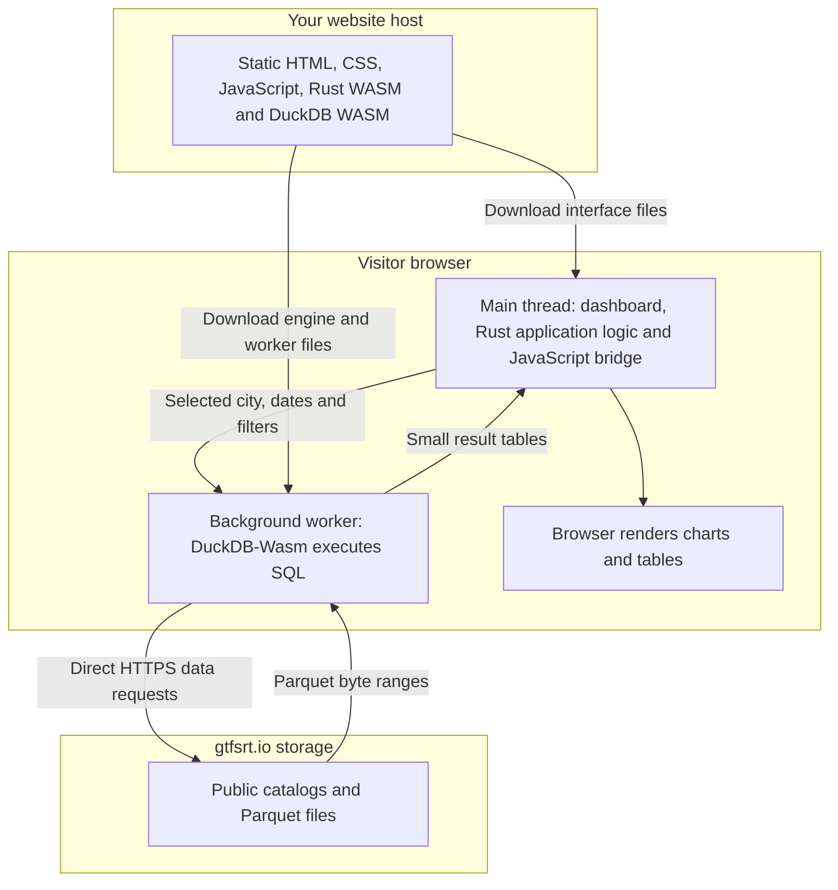
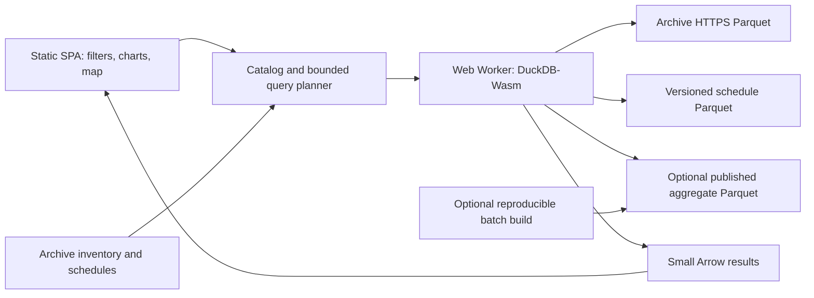

# Browser GTFS-RT dashboard architecture

Status: bounded Rust/WASM explorer implemented and tested in Chromium on 2026-11-06. This document retains the broader architecture and future gates. See [MVP validation](mvp-validation.md) for implemented scope and remaining checks, and [the feasibility decision](feasibility.md) for the original experiment.

The Rust implementation, self-contained release packaging and user-security requirements are detailed in [Rust packaging and browser security](packaging-security.md). The MVP implements the browser interface, bounded worker queries, self-hosted signed extensions and an enforced local preview policy; production HTTPS and broader browser validation remain open.

The initial product is a static web application that queries a bounded selection of archived transit data on the user's device. A successful direct-read experiment permits a city explorer; it does not establish that arbitrary national comparisons will fit a browser. Broad benchmarking should use small, reproducible aggregate Parquet datasets when raw scans exceed the measured limits.

## Decision and evidence boundary

| Item | Status |
| --- | --- |
| Canonical archive endpoint | Use `https://storage.googleapis.com/parquet.gtfsrt.io/`. |
| Transport checks | Browser confirmed public HEAD 200, byte-range GET 206, Parquet `PAR1` bytes, and CORS `*` on a Madison vehicle-position file. |
| Example object size | Madison vehicle positions, UTC date 2026-11-05: 34,180,170 bytes. This is one object's size, not a performance benchmark. |
| Direct DuckDB-Wasm query | Passed: counted 296,588 rows and grouped real route/vehicle/timestamp columns without a proxy. |
| Verified version | `@duckdb/duckdb-wasm` package `1.33.1-dev114.0`; SQL `version()` returned `v2.0.0`. The wrapper is a prerelease; package and engine versions are separate. |
| Historical schedules | Live `schedules.json` and `feeds.parquet` availability confirmed; applicability and join quality remain to be tested. |
| Capacity and performance | One sequence completed in 8.4 seconds; ranged GET lengths totalled 36.5 MB for the 34.2 MB object. All limits below remain proposed starting budgets. |

Do not use the homepage's `http://parquet.gtfsrt.io` examples in an HTTPS application. The transport check found a certificate mismatch on the custom HTTPS hostname. Retain the working Google Storage hostname in all catalog and query URLs.

The observed CORS response exposes `Content-Length` but not `Content-Range` or `ETag`. Do not make application code depend on reading unexposed headers. Ranged reads worked, but their combined ranges covered the entire object; this experiment does not establish efficient column or predicate pruning.

## System shape

The website host serves application files. Each visitor's browser runs the interface and database queries, and requests transit data directly from the archive.

Rust source is compiled on the development machine or in CI before deployment. Visitors download the resulting WASM modules; they do not install Rust or DuckDB. The website host needs static file delivery, not a Rust process, database process or query API. Each visitor has an independent DuckDB instance and working memory. A Web Worker is a browser execution context, not a process on the website host.

The component-level design is:

- Ship the interface, worker, WASM binaries and pinned dependencies as static assets. A JavaScript/TypeScript interface can use WASM for its analytical engine; the entire interface need not be compiled to WASM.
- Run analytical work in a dedicated worker so queries cannot block interaction. Serialize queries initially; expose cancellation and terminate/recreate the worker if cancellation cannot recover it.
- Use one browser DuckDB instance with a short-lived working set. Return aggregates or bounded samples to the interface, not complete daily tables.
- Begin with the pinned package's base bundle: `duckdb-base.wasm` and `duckdb-browser-base.worker.js`. Treat its optional threads bundle, cross-origin isolation and persistent browser storage as separate compatibility decisions; older examples using `eh`/`coi` filenames do not describe this package's assets.
- Register remote HTTPS URLs with `DuckDBDataProtocol.HTTP`; explicitly set `allowFullHTTPReads: false`, `forceFullHTTPReads: false` and `reliableHeadRequests: true`. These settings passed the probe; the pinned package's omitted forced-read default caused a reproducible failure.
- Host on a static HTTPS service. No query server, API key, user account or user-data upload is required for the initial direct mode. Requests go directly to the public archive.
- Use parameterized values and an allowlist of source URL prefixes and metric SQL templates. Render producer text as text, never as trusted HTML.

## Source contracts

The archive's [published-artifact contract](https://github.com/JarvusInnovations/gtfs-realtime-archiver/blob/main/specs/behaviors/published-artifacts.md) defines these resources:

| Resource | Purpose and constraints |
| --- | --- |
| `inventory.json` | Feed catalog with agency/system, URL/base64url, minimum/maximum date, total bytes and records. It is not a day-by-day availability manifest. |
| `feeds.parquet` | Feed metadata including polling interval and `schedule_url`/JSON `schedule_urls`. Use it to map realtime feeds to schedule sources. |
| `{type}/date={YYYY-MM-DD}/base64url={encoded}/data.parquet` | One realtime table per feed and fetch UTC day. Zstd compressed; may be replaced by recompaction. Zero-record output has no object. |
| `schedules.json` | Schedule sources and versions with digest, retrieval date and advertised coverage dates. |
| `schedules/base64url={encoded}/_feed_digest={digest}/` | Immutable schedule version directory containing metadata and per-table Parquet. Discover and verify the actual table paths before depending on them. |

Use the catalog's supplied base64url key. It encodes the base feed URL without authentication parameters; it is not an agency identifier. The public inventory lists three primary realtime types. Newer `trip_modifications`, `shapes` and `stops` tables exist in the source contract but are outside the initial scope.

The source contract marks raw protobuf private and the Parquet bucket public. The initial application therefore depends only on published Parquet and metadata, despite broader public-access wording on the landing page.

## Catalog, availability and query planning

1. Fetch and validate inventory and feed metadata; preserve retrieval time and the last successful result. Display source freshness.
2. Resolve a city through an explicit mapping to archive agency/system/feed IDs. A city can have several operators; an archive agency can span several cities.
3. Translate the selected local interval into the required UTC partitions, including adjacent dates when needed. Enumerate exact object URLs; do not rely on remote HTTP glob expansion.
4. Check candidate objects with bounded-concurrency HEAD requests and record content lengths. Distinguish 404, authorization failures and transient errors. An absent object is unknown/empty archive coverage, not proof of no transit service.
5. Apply the file/byte budget before issuing SQL. Project required columns and aggregate early. `LIMIT` on an aggregate result does not bound the underlying scan.
6. Read compatible files with Hive partitioning and `union_by_name`; inspect the available schema and supply typed nulls for required optional columns absent from every selected file.
7. Return result data together with queried files, excluded files, period, metric version, source versions and quality indicators.

Start with an ephemeral per-query object manifest. Add a small published manifest only if per-object checking becomes costly: exact URL, feed/table/date, bytes, schema fingerprint, row count where available, and verified availability time. Upstream daily files can change, so persisted cache entries need expiry/revalidation; URL alone is not an immutable identity. Schedule digests are immutable identities.

## Analytical model

The [compaction contract](https://github.com/JarvusInnovations/gtfs-realtime-archiver/blob/main/specs/behaviors/compaction.md) is mechanical extraction, not an event or performance model. Keep three distinct layers:

| Layer | Meaning |
| --- | --- |
| Archive observations | Preserve source file, feed, entity, fetch time, feed time and entity time. Vehicle positions have entity/snapshot grain; trip updates expand stop updates; alerts expand informed entities. |
| Normalized observations/events | Normalize identity and nulls, remove repeated identical observations according to an explicit rule, match schedule versions, and distinguish predictions from independently supported observed events. |
| Metric results | One declared unit per metric, with numerator, denominator, exclusions, coverage, method version and uncertainty. |

Use feed/system namespaces for trip, vehicle, route, stop and entity IDs. A trip ID alone does not identify a journey: retain service date and start time where necessary; retain stop sequence because a trip can visit the same stop repeatedly. Define deterministic tie-breaking using entity time, feed time, fetch time and source identity. Do not collapse a day's changing observations into one vehicle row except for an explicitly requested snapshot view.

`fetch_timestamp` is a UTC timestamp; `feed_timestamp`, vehicle `timestamp` and `trip_timestamp` are Unix seconds in the current [schema registry](https://github.com/JarvusInnovations/gtfs-realtime-archiver/blob/main/src/dagster_pipeline/defs/assets/schemas.py). Keep their meanings separate. Freshness uses available timestamps with a disclosed fallback; it must not silently treat missing event time as current.

Select historical schedules by service applicability and retrieval history, then validate trip/stop match rates. Record the selected digest and do not silently substitute today's schedule for historical data. Support multiple schedule sources per realtime feed. Missing or ambiguous mappings disable schedule-relative metrics.

Compute service dates using the appropriate schedule timezone and calendar/calendar exceptions. Handle GTFS times above 24:00:00 and daylight-saving transitions. UTC partition date, local calendar date and service date are different concepts. See the [GTFS Schedule reference](https://gtfs.org/documentation/schedule/reference/).

Schema additions are not guaranteed to exist in old partitions. Normalize empty IDs to missing where appropriate and interpret enum defaults field by field. Exclude unsupported differential feeds from state reconstruction: the archive captures `incrementality`, but payload-free deletion tombstones are not represented. Producer-specific protobuf extensions may also be absent from Parquet.

## Metrics and comparability

GTFS-RT trip updates describe predictions and may remove past stops. An absent update means unavailable information, not an on-time trip. These distinctions are required by the [GTFS Trip Updates documentation](https://gtfs.org/documentation/realtime/feed-entities/trip-updates/).

| Capability | Initial treatment |
| --- | --- |
| Archive freshness, days available, schema/field completeness | Supported after profiling; report archive coverage separately from service coverage. |
| Vehicle locations, distinct reported vehicles/trips, route activity | Bounded exploration; label as reported activity, not fleet size or completed service. |
| Reported/predicted delay distribution | Exploratory only; define observation selection/horizon, use eligible trip-stop units, report missingness, avoid snapshot-frequency weighting. |
| Active alerts | Deduplicate feed/entity across expanded rows; evaluate complete active-period arrays. Alert count is not a comparable disruption score across agencies. |
| On-time arrivals/departures, headway regularity, bunching | Later gate: validated stop-event reconstruction, historically matched schedules where required, declared thresholds and comparable route/mode groups. |
| Service delivered, cancellations, missed trips | Later gate: explicit published statuses or validated observations and a scheduled-service denominator. Missing realtime records never imply cancellation. |
| Passenger delay, ridership, operating efficiency | Outside scope without additional passenger and operating-cost data. |

Before a comparative metric appears, require a declared peer group, comparable modes and service windows, a consistent observation/event definition, sufficient coverage, schedule-match quality where applicable, and a published weighting rule. Show exclusions and denominators beside results. Distinguish zero, unavailable and ineligible. Do not present an overall agency league table by averaging unrelated measures.

Thresholds for metric eligibility must be selected after profiling representative agencies. They are part of the versioned metric definition, not undisclosed UI heuristics. Validate individual agency results before enabling comparisons.

## Proposed resource budgets

These conservative starting values require calibration against actual browsers and data. The object-size limit is an upper bound on selected compressed files, not a prediction of range-read traffic.

| Control | Proposed initial value |
| --- | --- |
| Default raw selection | One vehicle-position feed, one UTC day; disclose the local interval actually covered. |
| Maximum raw working set | Six daily objects and 128 MiB summed object sizes; both limits apply. |
| Object metadata concurrency | Four requests. |
| DuckDB configured memory target | 512 MiB, with observed total tab/worker memory measured separately. |
| Interactive query deadline | Request cancellation at 15 seconds; worker reset if still unresponsive at 30 seconds. |
| Result transfer | At most 20,000 table/chart rows; at most 10,000 map points with an explicit sampling/aggregation label. |

If a selection exceeds the budget, explain its estimated size and offer a smaller supported selection or a prepared aggregate dataset. A tighter time predicate alone may not reduce required I/O enough: measure Parquet row-group statistics and pruning rather than assuming it will. Never silently truncate the underlying population while reporting complete-service metrics.

## Broad benchmarking without a query server

An optional scheduled or manually invoked batch build can read the archive outside the browser, apply reviewed normalization and metric definitions, and publish aggregate Parquet plus a manifest to static object storage. This is a separate future component, not required for the first explorer.

Use a declared grain such as agency/system, route/mode, local service date, time band and metric version. Publish additive numerators/denominators and quality counts; use explicitly documented mergeable summaries where needed. Do not average precomputed percentiles or rates to create larger-period results. Include schedule digests, source coverage, exclusions and build provenance. Partition files so common comparisons fit the browser budget.

The same DuckDB-Wasm worker can read these datasets directly. Raw exploration remains available for evidence inspection. This approach preserves static hosting while moving expensive repeated computation to publication time.

## Delivery and acceptance gates

1. **Feasibility:** From an ordinary browser origin, with normal security settings and no data proxy, instantiate the pinned package, verify engine version, read archive metadata and query real Parquet columns. Observe range requests and record transferred bytes, timings, selected file, browser and errors. A native DuckDB or curl success does not pass this gate.
2. **Bounded explorer:** Demonstrate one complete supported selection with responsive cancellation, schema mismatch handling, missing-object handling and visible provenance. Validate results against an independent reference calculation. Test a cold and warm load.
3. **Browser support:** Exercise intended Chrome/Edge, Firefox and Safari versions and a constrained-memory device. Publish the supported matrix and limits; unsupported configurations get an actionable message.
4. **Analytical validity:** Profile representative vehicle, trip and alert feeds; test namespace collisions, repeated snapshots, absent timestamps, repeated stops, UTC boundaries, overnight service and DST. Validate historical schedule joins and source gaps before releasing affected metrics.
5. **Benchmarking:** Require the metric eligibility contract and resource budget to pass for the intended peer group and time range. Introduce prepared aggregates if direct queries cannot pass reliably.

The first implementation after feasibility is limited to a feed/city selector, date selection, coverage summary, bounded vehicle-position exploration and inspectable query/provenance results. Live operations monitoring, national rankings, route-performance claims, differential-feed reconstruction and a large persistent browser warehouse remain future work.
