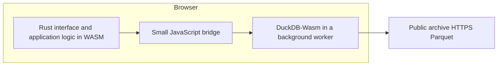

# Rust packaging and browser security

Design recommendation, November 6, 2026. The DuckDB browser experiment has passed. Rust integration, production packaging and the security controls below have not yet been implemented or verified.

## Recommended packaging

Ship one versioned static application release containing all executable dependencies. A visitor opens an HTTPS URL; they do not install Rust, npm, DuckDB or native software. The public archive remains an external data source.

For a Rust implementation, use a client-rendered Rust framework such as Leptos for the interface and application state, `wasm-bindgen` for a small JavaScript bridge, and the existing tested DuckDB-Wasm worker for SQL. Keep normal HTML controls, tables and accessible chart descriptions. A canvas/game-style renderer is not required to use WASM.

The Rust module can call asynchronous JavaScript functions and await their results through [wasm-bindgen](https://wasm-bindgen.github.io/wasm-bindgen/reference/js-promises-and-rust-futures.html). The bridge should expose a few typed operations—catalog discovery, bounded queries, cancellation and status—rather than an unrestricted execution interface. Keep large data in DuckDB and transfer small aggregates or appropriately sized Arrow buffers.

| Part | Release artifact |
| --- | --- |
| Rust UI, application rules and browser-compatible Rust dependencies | Application `.wasm` module |
| Rust/browser interoperability | Generated JavaScript plus a small maintained bridge |
| Analytical engine | Pinned DuckDB `.wasm` and matching worker/library JavaScript |
| Required DuckDB extensions, if any | Version/platform-matched signed files served with the application |
| Page, styles, icons and any chart library | Locally packaged static assets |
| Build tools | Used during development/CI; not required on visitors' computers |

Produce one `dist/` directory or release ZIP, with hashed asset names and atomic publication of matching assets. [Leptos supports static client-rendered deployment](https://book.leptos.dev/deployment/csr.html). Bundle the tested DuckDB build unchanged initially; its wrapper and engine versions differ, as documented in [the feasibility decision](feasibility.md).

Rust is a viable language choice, but it is not required for WASM analytics: the current JavaScript interface already runs the SQL engine in WASM. A Rust UI adds a compiler and interoperability boundary. It will not by itself reduce archive download sizes or make DuckDB queries faster.

## Why several files are appropriate

Browser game ports commonly combine compiled WASM with browser JavaScript and separate assets. [Emscripten documents these deployment components](https://emscripten.org/docs/compiling/Deploying-Pages.html). Its optional [single-file packaging](https://emscripten.org/docs/tools_reference/settings_reference.html#single-file) embeds resources into JavaScript/HTML; it does not remove the browser runtime or turn every component into a single standalone WASM module.

Most compatible Rust dependencies can be compiled into the Rust module. DuckDB is a C++ engine with a separate browser runtime. Linking Rust and DuckDB into one custom module is possible in principle, but requires custom toolchain/runtime integration. The [Rust Emscripten target](https://doc.rust-lang.org/rustc/platform-support/wasm32-unknown-emscripten.html) supports C/C++ interoperability and describes the compatibility requirements. The ordinary Rust browser target does not make native `duckdb` Cargo bindings a drop-in substitute for DuckDB-Wasm.

Maintaining that custom engine build would add upgrade and debugging work without establishing a security advantage. Prefer one deployable release with separately cacheable modules.

An installable/offline web application can be a later delivery option. Caching the application does not make uncached archive data available offline. Begin without a service worker; add one only with tested cache limits and coordinated asset-version updates.

## Security model

Protect the user's browser, local data, privacy and device resources from malicious source content, unexpected network requests, compromised dependencies and excessively large queries.

WASM runs within the browser's sandbox and can reach outside its memory only through exposed host APIs. That is useful protection, but does not make its code automatically trustworthy. Memory corruption inside a C++ module, abuse of permitted APIs and resource exhaustion remain possible. Rust reduces memory-safety errors in safe Rust application code; it does not change DuckDB's implementation or replace browser security policies. A worker keeps computation off the UI thread; it is not a separate security origin. See the [WebAssembly security model](https://webassembly.org/docs/security/).

Production requirements:

1. **Control executable dependencies.** Self-host pinned Rust, JavaScript, DuckDB and any necessary signed extension files. Review lockfile changes, scan dependencies, retain build provenance and apply security updates deliberately. Disable unnecessary extension installation/loading and unsigned/community extensions using settings verified against the chosen build. The currently tested wrapper is a prerelease and needs an explicit release-quality gate.
2. **Restrict browser capabilities and networking.** Request no filesystem, location, camera or other device permissions for archive exploration. Keep secrets and credentials out of all client assets. Serve an enforced Content Security Policy on both the page and worker responses, restricting scripts/workers to our release and connections to required application/archive endpoints. Permit WASM compilation without broadly enabling JavaScript evaluation. The exact policy must be tested, not copied into production on assumption.
3. **Constrain inputs before SQL.** Expose fixed analytical operations with prepared values. Validate dates, feed types, identifiers and result limits. Construct and validate HTTPS URLs by parsed origin and exact archive bucket/path prefix; allowing all of `storage.googleapis.com` would include unrelated buckets. Do not accept arbitrary SQL or fetch URLs from archive text, query strings or shared dashboard configurations.
4. **Treat archive text as data.** Escape names and alerts; never insert producer content as HTML or code. Validate link schemes and destinations. Do not automatically load images or other resources mentioned in archive content.
5. **Bound work and recover.** Cap selected objects, bytes, result sizes and concurrency. Apply a DuckDB memory target, query deadlines and a main-thread-controlled worker termination/reset path. Compressed file size and the database memory setting do not bound total browser memory. Validate behavior on constrained devices.
6. **Keep privacy claims precise.** Run SQL locally and avoid analytics and unnecessary third-party resources. Direct archive requests still disclose the requested objects and network address to the archive's hosting provider. A future map provider adds a separate network recipient. Use a restrictive referrer policy and make optional persistent caches visible and clearable.

[DuckDB's security guidance](https://duckdb.org/docs/2.0/operations_manual/securing_duckdb/overview) treats untrusted SQL and resource consumption as security concerns. WASM hosting narrows the available capabilities, but the application must still control what it asks DuckDB to do.

**Worker policy matters:** a same-origin worker generally does not inherit the document's CSP. `worker-src` limits worker creation; a CSP on the worker response constrains the worker's subsequent behavior. See [worker CSP](https://developer.mozilla.org/en-US/docs/Web/API/Web_Workers_API/Using_web_workers#content_security_policy) and [WASM compilation policy](https://developer.mozilla.org/en-US/docs/Web/HTTP/Reference/Headers/Content-Security-Policy/script-src#unsafe_webassembly_execution).

## Next acceptance gates

1. Build a minimal Rust page that repeats the existing Madison count and route aggregate through the tested DuckDB worker; assert engine version and result parity. This validates the new language boundary before a larger UI.
2. Produce a self-hosted release and inspect **every** network destination. The current feasibility recorder captures only archive requests, so it does not establish the absence of dynamic extension or CDN downloads.
3. Test enforced policies on an HTTPS host, including both page and worker. Confirm an off-allowlist URL is blocked, malicious alert markup displays literally, and supplied values cannot modify a query template.
4. Confirm an expensive or stalled query can be stopped, errors release resources, and an asset upgrade cannot mix incompatible JS/WASM versions. Test the selected browser support matrix.

Passing the existing data-access test establishes functionality. These additional gates establish a production packaging and security baseline; they are not a claim that any application is vulnerability-free.
